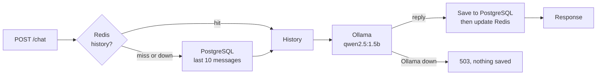
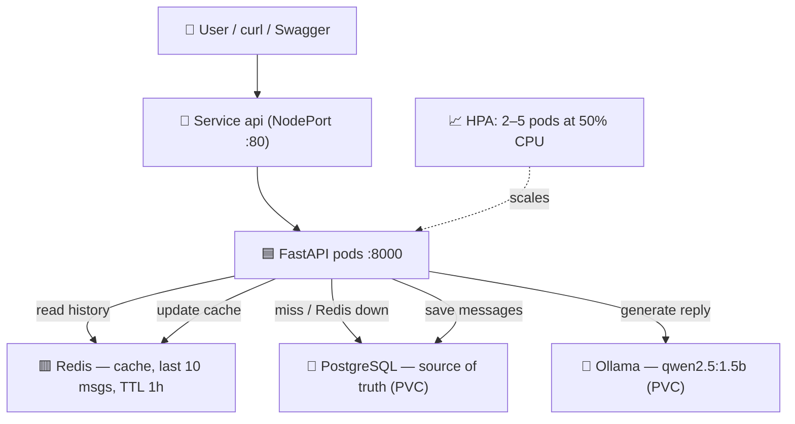
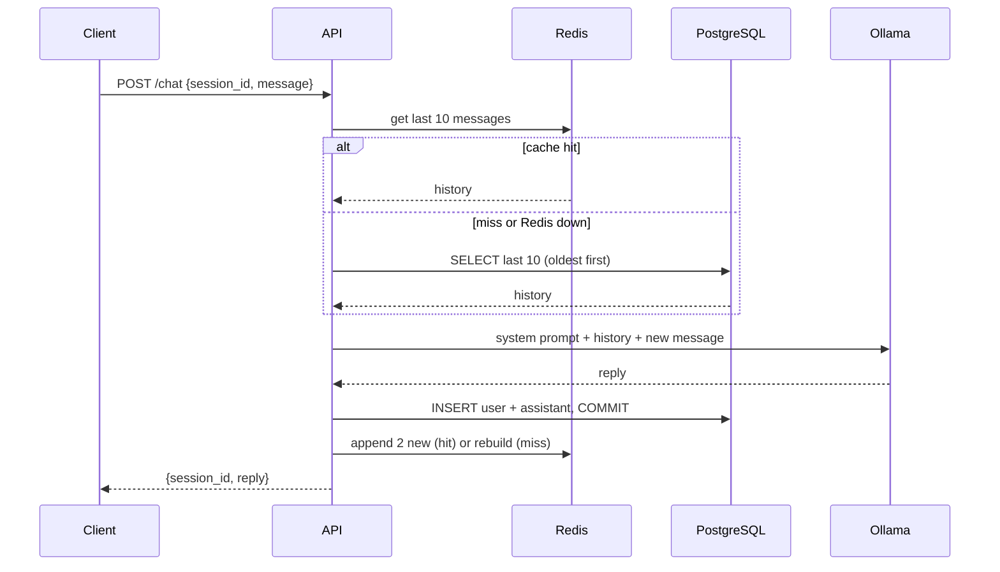

# 🤖 AI Chatbot Microservice — FastAPI, Ollama, Redis & PostgreSQL on Kubernetes

> A chatbot API that runs an open-source LLM locally, remembers every conversation in PostgreSQL, reads recent history from a Redis cache, and scales its API pods automatically on Kubernetes.


---

## 📌 Table of Contents

<details open>
<summary><b>Click to expand / collapse navigation</b></summary>

- [🔎 Overview](#-overview)
- [📸 Demo](#-demo)
- [🧠 Why Does a Chatbot Need Memory?](#-why-does-a-chatbot-need-memory)
- [🎯 What This Project Does](#-what-this-project-does)
- [🏗️ Architecture](#️-architecture)
- [🛠️ Technology Stack](#️-technology-stack)
- [📁 Project Structure](#-project-structure)
- [✨ Key Features](#-key-features)
- [🧩 Design Decisions](#-design-decisions)
- [⚡ Quick Start](#-quick-start)
- [⚙️ Setup & Installation](#️-setup--installation)
- [🚀 Request Walkthrough](#-request-walkthrough)
- [🎥 YouTube Demonstration](#-youtube-demonstration)
- [🧩 Troubleshooting](#-troubleshooting)
- [🧪 Testing](#-testing)
- [⚠️ Known Limitations](#️-known-limitations)
- [📌 Assignment Coverage](#-assignment-coverage)
- [👨‍💻 Author](#-author)

</details>

---

## 🔎 Overview

This project is an AI chatbot microservice. `POST /chat` takes a `session_id` and a message, sends the conversation to a local LLM and returns the reply:

1. **History** — the last 10 messages of the session are read from **Redis**, or from **PostgreSQL** if the cache is empty or Redis is down
2. **Reply** — the history plus the new message goes to **Ollama** (`qwen2.5:1.5b`)
3. **Store** — both messages are saved to PostgreSQL, then the Redis cache is updated

The four services run together with **Docker Compose** or on **Kubernetes**, where an **HPA** scales the API between 2 and 5 pods.

---

## 📸 Demo

> The bot recalls an earlier message in the same session.

<!-- Add a screenshot or GIF of /docs here: assets/demo.png -->

```bash
curl -X POST localhost:8000/chat -H "Content-Type: application/json" \
  -d '{"session_id":"demo","message":"My favourite colour is green."}'

curl -X POST localhost:8000/chat -H "Content-Type: application/json" \
  -d '{"session_id":"demo","message":"What is my favourite colour?"}'
# {"session_id":"demo","reply":"Green."}
```

---

## 🧠 Why Does a Chatbot Need Memory?

| Question | Answer in this project |
|----------|------------------------|
| **Does the LLM remember the conversation?** | No. It only sees the messages sent in the current request, so the app must send the history every time |
| **Where is the history stored?** | PostgreSQL, so it survives restarts and pod replacements |
| **How do we avoid a database read on every message?** | Redis caches the last 10 messages per session |
| **What if a dependency fails?** | Redis down → fall back to PostgreSQL. Ollama down → clean `503`, nothing saved |

---

## 🎯 What This Project Does



---

## 🏗️ Architecture



### Component Breakdown

| Component | Role |
|-----------|------|
| **FastAPI app** | `/chat` and `/health`; stateless, so any pod can serve any session |
| **PostgreSQL** | Stores every message; the source of truth, on a PersistentVolume |
| **Redis** | Caches the last 10 messages per session; no disk persistence |
| **Ollama** | Runs the LLM; the heaviest component (~2 GB memory), kept at 1 replica |
| **Service** | One stable address for the API pods (port 80 → 8000) |
| **HPA** | Adds API pods when average CPU goes above 50% of the request, up to 5 |
| **ConfigMap / Secret** | Connection settings; the database password lives only in the Secret |

### Request Flow



---

## 🛠️ Technology Stack

| Layer | Technology | Function |
|-------|------------|----------|
| **Application** | Python 3.12, FastAPI, Pydantic | API and request validation |
| **LLM** | Ollama, `qwen2.5:1.5b` | Local open-source model, no API key |
| **Database** | PostgreSQL 16, SQLAlchemy 2.0 | Chat history |
| **Cache** | Redis 7 | Recent history per session |
| **Testing** | pytest, fakeredis, in-memory SQLite | Tests without real services |
| **Quality** | ruff, pre-commit, GitHub Actions | Lint, format, tests and Docker build on every push |
| **Container** | Docker, Docker Compose | Four-service local stack |
| **Orchestration** | Kubernetes (Docker Desktop), metrics-server | Deployments, Services, PVCs, HPA |

---

## 📁 Project Structure

```text
ai-chatbot-k8s/
│
├── src/app/
│   ├── main.py                   # /health, /chat, Ollama client, history loading
│   ├── cache.py                  # Redis cache, never raises
│   ├── db.py                     # SQLAlchemy engine + session per request
│   ├── models.py                 # Message table
│   └── config.py                 # Settings from env / .env
│
├── tests/
│   ├── conftest.py               # In-memory SQLite + fakeredis for every test
│   ├── test_chat.py              # Reply, 503, history, cache hit/miss, Redis down
│   └── test_health.py
│
├── k8s/
│   ├── 00-namespace.yaml
│   ├── 01-configmap.yaml         # REDIS_URL, OLLAMA_URL, OLLAMA_MODEL
│   ├── 02-secret.yaml.example    # Copy to 02-secret.yaml (git-ignored)
│   ├── 10-db.yaml                # Postgres: PVC + Deployment + Service
│   ├── 20-redis.yaml             # Redis: Deployment + Service
│   ├── 30-ollama.yaml            # Ollama: PVC + Deployment + Service
│   ├── 40-api.yaml               # API: Deployment + NodePort Service
│   └── 50-hpa.yaml               # HPA: 2–5 api pods at 50% CPU
│
├── docs/decisions.md             # Design decision records
├── .github/workflows/ci.yml      # Lint → test → Docker build
├── docker-compose.yml            # api + db + redis + ollama
├── Dockerfile
├── Makefile
└── README.md
```

---

## ✨ Key Features

- 🧠 **Conversation memory:** history per `session_id`, sent to the LLM on every turn
- ⚡ **Redis cache with fallback:** cache first; PostgreSQL on a miss or when Redis is down
- 🛡️ **Graceful failures:** Redis down → still `200`; Ollama down → clean `503`, nothing saved
- 🔒 **Consistent writes:** commit to PostgreSQL *before* updating the cache
- 📈 **Autoscaling:** HPA scales the API from 2 to 5 pods on CPU
- ☸️ **Self-healing:** a deleted API pod is replaced and the conversation continues
- 🔐 **No secrets in git:** only a `.example` Secret is committed

---

## 🧩 Design Decisions

Full records in [docs/decisions.md](docs/decisions.md).

| Decision | Why |
|----------|-----|
| **PostgreSQL is the source of truth, Redis is only a cache** | The chat keeps working if Redis fails |
| **Commit to Postgres before updating Redis** | Redis can never hold messages Postgres doesn't have |
| **Send the last 10 messages on both cache hit and miss** | Same behaviour either way; fits a small model's context window |
| **System prompt telling the model to use the history** | The small model ignored history without it |
| **Redis without persistence** | Avoids a stale cache after a restart; an empty Redis rebuilds from Postgres |
| **Scale only the API; Ollama stays at 1** | The API is light and stateless; one LLM copy needs ~2 GB |
| **`Recreate` strategy for db and ollama** | A ReadWriteOnce volume can be mounted by only one pod at a time |
| **Same Service names as Compose (`db`, `redis`, `ollama`)** | The same connection URLs work in both environments |

---

## ⚡ Quick Start

> Run the whole stack with Docker Compose.

```bash
docker compose up -d --build
docker compose exec ollama ollama pull qwen2.5:1.5b   # once; stored in a volume
# Open http://localhost:8000/docs and try POST /chat
```

---

## ⚙️ Setup & Installation

### Prerequisites

| Tool | Purpose | Install |
|------|---------|---------|
| Python 3.12+ | Local development and tests | [python.org](https://www.python.org/downloads/) |
| Docker Desktop | Compose and local Kubernetes | [Download](https://www.docker.com/products/docker-desktop/) |
| kubectl | Kubernetes CLI | Bundled with Docker Desktop |
| Ollama | LLM for local development (optional) | [ollama.com](https://ollama.com) |

### 1. Run locally

```bash
python -m venv .venv && source .venv/bin/activate
cp .env.example .env
make install
docker run -d --name chat-postgres -e POSTGRES_USER=app -e POSTGRES_PASSWORD=app -e POSTGRES_DB=chatdb -p 5432:5432 postgres:16
docker run -d --name chat-redis -p 127.0.0.1:6379:6379 redis:7
ollama serve                  # in its own terminal tab
ollama pull qwen2.5:1.5b
make run                      # http://localhost:8000/docs
```

### 2. Run with Docker Compose

See [Quick Start](#-quick-start).

### 3. Deploy to Kubernetes (Docker Desktop)

```bash
# 1. Secret (02-secret.yaml is git-ignored). Replace BOTH CHANGE_ME values with the same password.
cp k8s/02-secret.yaml.example k8s/02-secret.yaml

# 2. Build the api image
docker build -t ai-chatbot-api:0.1 .

# 3. Copy the image into the cluster node (it has its own image store). Repeat after every rebuild.
docker save ai-chatbot-api:0.1 | docker exec -i desktop-control-plane ctr -n k8s.io images import -

# 4. Install metrics-server once (the HPA needs CPU metrics).
#    --kubelet-insecure-tls is for local clusters only.
kubectl apply -f https://github.com/kubernetes-sigs/metrics-server/releases/latest/download/components.yaml
kubectl patch deployment metrics-server -n kube-system --type=json \
  -p='[{"op":"add","path":"/spec/template/spec/containers/0/args/-","value":"--kubelet-insecure-tls"}]'

# 5. Deploy and wait for the pods
kubectl apply -f k8s/
kubectl -n ai-chatbot rollout status deploy/ollama
kubectl -n ai-chatbot rollout status deploy/api

# 6. Pull the model once (stored on the ollama PVC)
kubectl -n ai-chatbot exec deploy/ollama -- ollama pull qwen2.5:1.5b

# 7. Try it
kubectl -n ai-chatbot port-forward svc/api 8000:80   # then: curl localhost:8000/health
```

After rebuilding the image: repeat step 3, then `kubectl -n ai-chatbot rollout restart deploy/api`.

---

## 🚀 Request Walkthrough

| Step | Component | What happens |
|------|-----------|--------------|
| 1 | **API** | Validates `session_id` and `message` (empty → `422`) |
| 2 | **Redis** | Reads `chat:{session_id}`; a miss or error returns nothing |
| 3 | **PostgreSQL** | On a miss, loads the last 10 messages, oldest first |
| 4 | **Ollama** | Receives the system prompt + history + new message; returns the reply |
| 5 | **PostgreSQL** | Saves the user and assistant messages and commits |
| 6 | **Redis** | Hit: appends the 2 new messages. Miss: rebuilds from Postgres + the new pair. Keeps 10, TTL 1 h |

### Demonstrating Self-Healing

```bash
kubectl -n ai-chatbot delete pod <api-pod-that-served-the-chat>
kubectl -n ai-chatbot get pods -w        # a replacement starts in seconds
```
The next `/chat` in the same session still recalls the earlier message: the history lives in PostgreSQL, not in the pod.

### Demonstrating Autoscaling

```bash
kubectl -n ai-chatbot get hpa -w         # terminal 1: watch replicas
kubectl -n ai-chatbot run load --image=busybox:1.36 --restart=Never -- /bin/sh -c \
  'for i in $(seq 1 20); do (while true; do wget -q -O- http://api/health >/dev/null; done) & done; wait'
kubectl -n ai-chatbot delete pod load    # stop the load; replicas return to 2 after ~5 minutes
```

---

## 🎥 YouTube Demonstration

| # | Section |
|---|---------|
| 1 | The problem — an LLM has no memory |
| 2 | Architecture — API, PostgreSQL, Redis, Ollama and why each exists |
| 3 | `kubectl get pods` — everything running in the cluster |
| 4 | Chat through the Service — the bot recalls an earlier message |
| 5 | History in PostgreSQL (`SELECT`) and Redis (`LRANGE`) |
| 6 | Delete the API pod — a new pod starts and the history survives |
| 7 | Autoscaling — load test, HPA adds pods, then scales back down |

---

## 🧩 Troubleshooting

<details>
<summary><b>❌ ErrImageNeverPull on the api pods</b></summary>

Docker Desktop's Kubernetes node has its own image store. Import the image, then restart:
```bash
docker save ai-chatbot-api:0.1 | docker exec -i desktop-control-plane ctr -n k8s.io images import -
kubectl -n ai-chatbot rollout restart deploy/api
```
</details>

<details>
<summary><b>❌ HPA shows &lt;unknown&gt;/50% or "Metrics API not available"</b></summary>

metrics-server is missing or not ready. Install it (Setup step 4), wait about a minute, then check:
```bash
kubectl top pods -n ai-chatbot
```
</details>

<details>
<summary><b>❌ /chat returns 503 "LLM Service not available"</b></summary>

Ollama isn't reachable or the model isn't pulled:
```bash
kubectl -n ai-chatbot exec deploy/ollama -- ollama list
kubectl -n ai-chatbot exec deploy/ollama -- ollama pull qwen2.5:1.5b
```
</details>

<details>
<summary><b>❌ The bot doesn't remember earlier messages</b></summary>

Check each layer before blaming the model:
```bash
kubectl -n ai-chatbot exec deploy/db -- psql -U app -d chatdb -c "SELECT role, left(content,40) FROM messages WHERE session_id='demo';"
kubectl -n ai-chatbot exec deploy/redis -- redis-cli LRANGE chat:demo 0 -1
```
If both show the history, it reached the model; the system prompt in `main.py` helps small models use it.
</details>

<details>
<summary><b>❌ ERROR: [Errno 48] Address already in use</b></summary>

An old server is still running on port 8000:
```bash
lsof -ti :8000 | xargs kill
```
</details>

<details>
<summary><b>❌ git commit fails: "files were modified by this hook"</b></summary>

A pre-commit hook fixed formatting on disk. Stage the fixed files and commit again:
```bash
git add . && git commit -m "..."
```
</details>

---

## 🧪 Testing

```bash
make check     # ruff lint + pytest
```

Tests never touch real services: the LLM call is replaced by a fake, PostgreSQL by in-memory SQLite and Redis by `fakeredis`.

| Test | Proves |
|------|--------|
| `test_chat_returns_reply` | Happy path returns the model's reply |
| `test_chat_returns_503_when_llm_down` | Ollama failure gives a clean 503 |
| `test_chat_sends_session_history` | Earlier messages reach the LLM in order, with correct roles |
| `test_chat_cache_miss_fills_cache` | A miss rebuilds the Redis cache |
| `test_chat_cache_hit_uses_cached_history` | A hit reads Redis, not Postgres |
| `test_chat_falls_back_to_postgres_when_redis_down` | Redis down → still 200, history from Postgres |

---

## ⚠️ Known Limitations

- **Readiness = liveness (`/health`):** it doesn't check the database, so pods stay Ready while Postgres is down.
- **No startup ordering:** on a fresh cluster the API can restart a few times until Postgres is ready.
- **No authentication:** anyone who can reach the NodePort can read a session's history by its `session_id`.
- **No `securityContext` or NetworkPolicy:** containers aren't locked down and any pod can reach db, redis and ollama.
- **Local image import:** the cluster uses an imported image, not a registry.

---

## 📌 Assignment Coverage

| Requirement | Implementation | Status |
|-------------|---------------|:------:|
| **FastAPI** | `/chat` and `/health` | ✅ |
| **Ollama / Open-source LLM** | Ollama with `qwen2.5:1.5b` | ✅ |
| **Redis** | Cache of the last 10 messages per session, with fallback | ✅ |
| **PostgreSQL** | Chat history, source of truth | ✅ |
| **Dockerize** | `Dockerfile` + `docker-compose.yml` | ✅ |
| **Deploy on Kubernetes** | Manifests in `k8s/` | ✅ |
| **Expose using Service** | `api` NodePort Service | ✅ |
| **Store chat history** | PostgreSQL, verified across pod deletion | ✅ |
| **Horizontal Scaling (Bonus)** | HPA: 2–5 API pods at 50% CPU (`k8s/50-hpa.yaml`) | ✅ |
| **YouTube Submission** | Chatbot working inside Kubernetes | ⬜ |

---

## 👨‍💻 Author

**Vijay Rangvani**
*Backend & AI Engineering Learner | Healthcare IT*

| | |
|--|--|
| 🐙 GitHub | [github.com/vijayrangvani](https://github.com/vijayrangvani) |
| 💼 LinkedIn | [linkedin.com/in/vijayrangvani](https://www.linkedin.com/in/vijayrangvani/) |

**Focus Areas:** Python · FastAPI · LLMs · PostgreSQL · Redis · Docker · Kubernetes
