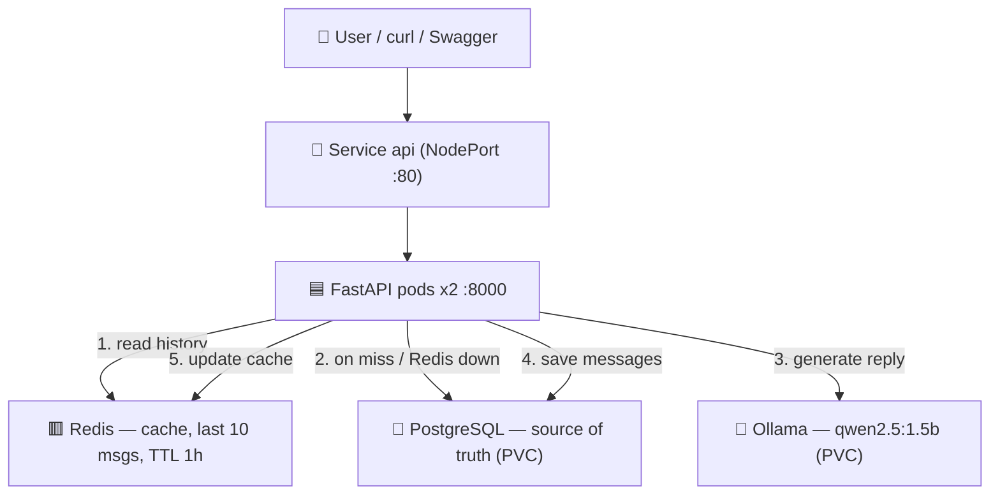
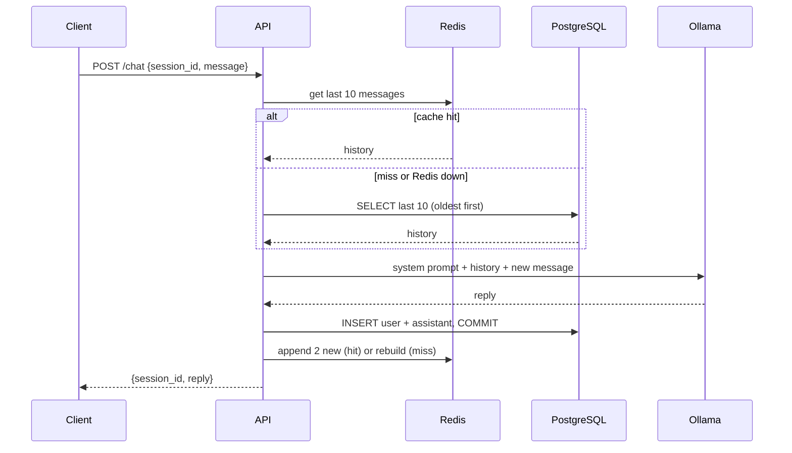

# 🤖 AI Chatbot Microservice: FastAPI, Ollama, Redis and PostgreSQL on Kubernetes

> A chatbot API that runs an open-source LLM locally, remembers each conversation in PostgreSQL, speeds up history reads with a Redis cache, and keeps working when the cache is down. Runs with Docker Compose or on Kubernetes.

[](https://github.com/vijayrangvani/ai-chatbot-k8s/actions/workflows/ci.yml)


---

## 📌 Table of Contents

<details open>
<summary><b>Click to expand / collapse navigation</b></summary>

- [🔎 Overview](#-overview)
- [📸 Demo](#-demo)
- [❓ Problem](#-problem)
- [🏗️ Architecture](#️-architecture)
- [🔁 Request Flow](#-request-flow)
- [🛠️ Technology Stack](#️-technology-stack)
- [📁 Project Structure](#-project-structure)
- [✨ Key Features](#-key-features)
- [🧭 Design Decisions](#-design-decisions)
- [⚡ Quick Start](#-quick-start)
- [⚙️ Setup & Installation](#️-setup--installation)
- [🧪 Testing](#-testing)
- [🎥 YouTube Demonstration](#-youtube-demonstration)
- [🔧 Troubleshooting](#-troubleshooting)
- [⚠️ Known Limitations](#️-known-limitations)
- [🚧 What I'd Do Next](#-what-id-do-next)
- [📌 Assignment Coverage](#-assignment-coverage)
- [👨‍💻 Author](#-author)

</details>

---

## 🔎 Overview

`POST /chat` takes a `session_id` and a message, sends the conversation to a local LLM (Ollama, `qwen2.5:1.5b`) and returns the reply. Every message is stored, so the bot remembers earlier turns in the same session.

- **PostgreSQL** is the source of truth for chat history
- **Redis** caches the last 10 messages per session, so most requests skip the database
- If **Redis is down**, the API falls back to PostgreSQL instead of failing
- If **Ollama is down**, the API returns a clean `503` and saves nothing
- The same four containers run with **Docker Compose** locally or on **Kubernetes**

---

## 📸 Demo

<!-- Add a GIF or screenshot of /docs showing the chatbot recalling an earlier message, e.g. assets/demo.gif -->

```bash
curl -X POST localhost:8000/chat -H "Content-Type: application/json" \
  -d '{"session_id":"demo","message":"My favourite colour is green."}'

curl -X POST localhost:8000/chat -H "Content-Type: application/json" \
  -d '{"session_id":"demo","message":"What is my favourite colour?"}'
# {"session_id":"demo","reply":"Green."}
```

---

## ❓ Problem

An LLM has **no memory**: it only sees the messages sent in the current request. To hold a conversation, the app must store every turn and send the history back each time. That raises three engineering questions this project answers:

1. **Where does history live**, so it survives restarts and pod replacements? → PostgreSQL
2. **How do we avoid a database read on every message?** → a Redis cache
3. **What happens when a dependency fails?** → degrade gracefully instead of crashing

---

## 🏗️ Architecture



### Component Breakdown

| Component | Role | Scales? |
|-----------|------|:------:|
| **FastAPI app** | `/chat` and `/health`; stateless, so any pod can serve any session | ✅ 2 replicas |
| **PostgreSQL** | Stores every message; the source of truth | ❌ 1 (holds data) |
| **Redis** | Caches the last 10 messages per session; no persistence | ❌ 1 |
| **Ollama** | Runs the LLM; the heaviest component (~2 GB memory) | ❌ 1 (too heavy to copy) |

---

## 🔁 Request Flow



---

## 🛠️ Technology Stack

| Layer | Technology | Function |
|-------|------------|----------|
| **API** | Python 3.12, FastAPI, Pydantic | Endpoints and request validation |
| **LLM** | Ollama, `qwen2.5:1.5b` | Local open-source model, no API key |
| **Database** | PostgreSQL 16, SQLAlchemy 2.0, psycopg 3 | Chat history |
| **Cache** | Redis 7, redis-py | Recent history per session |
| **Config** | pydantic-settings, `.env` | Settings from environment variables |
| **Testing** | pytest, fakeredis, in-memory SQLite | Fast tests with no real services |
| **Quality** | ruff, pre-commit, GitHub Actions | Lint, format, tests and Docker build on every push |
| **Containers** | Docker, Docker Compose | Local four-service stack |
| **Orchestration** | Kubernetes (Docker Desktop) | Deployments, Services, PVCs, ConfigMap, Secret |

---

## 📁 Project Structure

```text
ai-chatbot-k8s/
│
├── src/app/
│   ├── main.py            # /health, /chat, Ollama client, history loading
│   ├── cache.py           # Redis cache: get_history / append_messages, never raises
│   ├── db.py              # SQLAlchemy engine + session per request
│   ├── models.py          # Message table
│   └── config.py          # Settings from env / .env
│
├── tests/
│   ├── conftest.py        # In-memory SQLite + fakeredis for every test
│   ├── test_chat.py       # Reply, 503, history, cache hit/miss, Redis down
│   └── test_health.py
│
├── k8s/
│   ├── 00-namespace.yaml
│   ├── 01-configmap.yaml          # REDIS_URL, OLLAMA_URL, OLLAMA_MODEL
│   ├── 02-secret.yaml.example     # copy to 02-secret.yaml (git-ignored)
│   ├── 10-db.yaml                 # Postgres: PVC + Deployment + Service
│   ├── 20-redis.yaml              # Redis: Deployment + Service
│   ├── 30-ollama.yaml             # Ollama: PVC + Deployment + Service
│   └── 40-api.yaml                # API: Deployment (2 replicas) + NodePort Service
│
├── docs/decisions.md      # Design decisions and trade-offs
├── docker-compose.yml     # api + db + redis + ollama
├── Dockerfile
├── Makefile               # install / run / test / check / format
└── pyproject.toml
```

---

## ✨ Key Features

- 🧠 **Conversation memory:** history per `session_id`, sent to the LLM on every turn
- ⚡ **Redis cache with fallback:** cache first; PostgreSQL on a miss or when Redis is down
- 🛡️ **Graceful failures:** Redis down → still `200`; Ollama down → clean `503`, nothing saved
- 🔒 **Consistent writes:** commit to PostgreSQL *before* updating the cache
- 🧪 **Tests without services:** fake LLM, in-memory DB and fakeredis; regression test for a real history bug
- ☸️ **Kubernetes-ready:** probes, resource limits, PVCs, `Recreate` strategy for volume-backed pods
- 🔐 **No secrets in git:** settings via env; only a `.example` Secret is committed

---

## 🧭 Design Decisions

Full records in [docs/decisions.md](docs/decisions.md).

| Decision | Why |
|----------|-----|
| **PostgreSQL is the source of truth, Redis is only a cache** | The chat must keep working if Redis fails |
| **Commit to Postgres before updating Redis** | Redis can never hold messages Postgres doesn't have |
| **Send the last 10 messages on both cache hit and miss** | Same behaviour either way; fits a small model's context window |
| **System prompt telling the model to use the history** | The small model ignored history without it ("As an AI, I don't have personal information") |
| **Redis without persistence** | Avoids a stale cache after a restart; an empty Redis rebuilds from Postgres |
| **Ollama as its own Deployment, never scaled** | The API scales cheaply; one LLM copy needs ~2 GB |
| **`Recreate` strategy for db and ollama** | A ReadWriteOnce volume can only be mounted by one pod at a time |
| **Same Service names as Compose (`db`, `redis`, `ollama`)** | The same connection URLs work in both environments, with no code change |

---

## ⚡ Quick Start

> Run the whole stack with Docker Compose.

```bash
docker compose up -d --build
docker compose exec ollama ollama pull qwen2.5:1.5b   # once; stored in a volume
# Open http://localhost:8000/docs and try POST /chat
```

---

## ⚙️ Setup & Installation

### Prerequisites

| Tool | Purpose | Install |
|------|---------|---------|
| Python 3.12+ | Local development and tests | [python.org](https://www.python.org/downloads/) |
| Docker Desktop | Compose and local Kubernetes | [Download](https://www.docker.com/products/docker-desktop/) |
| kubectl | Kubernetes CLI | Bundled with Docker Desktop |
| Ollama | LLM for local development (optional) | [ollama.com](https://ollama.com) |

### 1. Run locally (fastest for development)

```bash
python -m venv .venv && source .venv/bin/activate
cp .env.example .env
make install
docker run -d --name chat-postgres -e POSTGRES_USER=app -e POSTGRES_PASSWORD=app -e POSTGRES_DB=chatdb -p 5432:5432 postgres:16
docker run -d --name chat-redis -p 127.0.0.1:6379:6379 redis:7
ollama serve                 # in its own terminal tab
ollama pull qwen2.5:1.5b
make run          # http://localhost:8000/docs
```

### 2. Run with Docker Compose

See [Quick Start](#-quick-start).

### 3. Deploy to Kubernetes

Tested on Docker Desktop's Kubernetes. Manifests are in `k8s/`, numbered in apply order.

```bash
# 1. Secret (02-secret.yaml is git-ignored). Replace BOTH CHANGE_ME values with the same password.
cp k8s/02-secret.yaml.example k8s/02-secret.yaml

# 2. Build the api image
docker build -t ai-chatbot-api:0.1 .

# 3. Copy the image into the cluster node. Docker Desktop's node has its own image store, so
#    `imagePullPolicy: Never` can't see your local images. Repeat after every rebuild.
#    Node name: `kubectl get nodes`
docker save ai-chatbot-api:0.1 | docker exec -i desktop-control-plane ctr -n k8s.io images import -

# 4. Deploy and wait for the pods
kubectl apply -f k8s/
kubectl -n ai-chatbot rollout status deploy/ollama
kubectl -n ai-chatbot rollout status deploy/api

# 5. Pull the model once (stored on the ollama PVC, survives pod restarts)
kubectl -n ai-chatbot exec deploy/ollama -- ollama pull qwen2.5:1.5b

# 6. Try it
kubectl -n ai-chatbot port-forward svc/api 8000:80   # then: curl localhost:8000/health
```

After rebuilding the image: repeat step 3, then `kubectl -n ai-chatbot rollout restart deploy/api`.

---

## 🧪 Testing

```bash
make check     # ruff lint + pytest
```

Tests never touch real services: `ask_ollama` is replaced by a fake, PostgreSQL by in-memory SQLite (`dependency_overrides`) and Redis by `fakeredis`.

| Test | Proves |
|------|--------|
| `test_chat_returns_reply` | Happy path returns the model's reply |
| `test_chat_returns_503_when_llm_down` | Ollama failure gives a clean 503 |
| `test_chat_sends_session_history` | Regression test: earlier messages reach the LLM in order, with correct roles |
| `test_chat_cache_miss_fills_cache` | A miss rebuilds the Redis cache |
| `test_chat_cache_hit_uses_cached_history` | A hit reads Redis, not Postgres |
| `test_chat_falls_back_to_postgres_when_redis_down` | Redis down → still 200, history from Postgres |

**Verified manually on Kubernetes:** deleted the API pod that served a conversation; Kubernetes replaced it in ~6 s and the new pod still recalled the earlier message.

---

## 🎥 YouTube Demonstration

| # | Section |
|---|---------|
| 1 | The problem: an LLM has no memory |
| 2 | Architecture: API, Postgres, Redis, Ollama and why each exists |
| 3 | `kubectl get pods`: everything running in the cluster |
| 4 | Chat through the Service: the bot recalls an earlier message |
| 5 | History in Postgres (`SELECT`) and Redis (`LRANGE`) |
| 6 | Delete the API pod: a new pod starts and the history survives |
| 7 | Design decisions and known limitations |

---

## 🔧 Troubleshooting

<details>
<summary><b>❌ ErrImageNeverPull on the api pods</b></summary>

Docker Desktop's Kubernetes node has its own image store and can't see images built with `docker build`. Import the image into the node, then restart the pods:
```bash
docker save ai-chatbot-api:0.1 | docker exec -i desktop-control-plane ctr -n k8s.io images import -
kubectl -n ai-chatbot rollout restart deploy/api
```
</details>

<details>
<summary><b>❌ /chat returns 503 "LLM Service not available"</b></summary>

Ollama isn't reachable, or the model isn't pulled yet:
```bash
kubectl -n ai-chatbot exec deploy/ollama -- ollama list
kubectl -n ai-chatbot exec deploy/ollama -- ollama pull qwen2.5:1.5b
```
</details>

<details>
<summary><b>❌ The bot doesn't remember earlier messages</b></summary>

Check each layer before blaming the model:
```bash
kubectl -n ai-chatbot exec deploy/db -- psql -U app -d chatdb -c "SELECT role, left(content,40) FROM messages WHERE session_id='demo';"
kubectl -n ai-chatbot exec deploy/redis -- redis-cli LRANGE chat:demo 0 -1
```
If both show the history, it reached the model. Small models can still answer generically; the system prompt in `main.py` reduces this.
</details>

<details>
<summary><b>❌ ERROR: [Errno 48] Address already in use</b></summary>

An old server is still running on port 8000. Stop it, then start again:
```bash
lsof -ti :8000 | xargs kill
```
</details>

<details>
<summary><b>❌ git commit fails: "files were modified by this hook"</b></summary>

A pre-commit hook fixed formatting on disk. Stage the fixed files and commit again:
```bash
git add . && git commit -m "..."
```
</details>

<details>
<summary><b>❌ check-yaml: "expected a single document in the stream"</b></summary>

Kubernetes files hold several resources separated by `---`. The hook needs `args: [--allow-multiple-documents]` in `.pre-commit-config.yaml` (already set).
</details>

---

## ⚠️ Known Limitations

- **Readiness = liveness (`/health`):** it doesn't check the database, so pods stay Ready and get traffic while Postgres is down.
- **No startup ordering:** on a fresh cluster the api can crash-loop until Postgres is ready, and both replicas run `create_all` at the same time.
- **No authentication:** the NodePort exposes `/chat`, and anyone who can reach it can read any session's history by its `session_id`.
- **No `securityContext`:** containers don't enforce non-root or drop privileges; Ollama runs as root.
- **No network isolation:** no NetworkPolicy and no Redis password, so any pod in the cluster can reach db, redis and ollama.
- **Local image import:** the cluster uses a locally imported image, not a registry.

---

## 🚧 What I'd Do Next

- **Horizontal Pod Autoscaler** for the API (assignment bonus)
- A `/ready` endpoint that checks PostgreSQL, used as the readiness probe
- Push the image to a registry and deploy by version tag
- Pin image versions (`ollama/ollama`, `postgres`, `redis`) for reproducible deploys
- Add authentication before exposing the API beyond a local cluster

---

## 📌 Assignment Coverage

| Requirement | Implementation | Status |
|-------------|---------------|:------:|
| **FastAPI** | `/chat` and `/health` in `src/app/main.py` | ✅ |
| **Ollama / open-source LLM** | Ollama with `qwen2.5:1.5b` | ✅ |
| **Redis** | Cache of the last 10 messages per session, with fallback | ✅ |
| **PostgreSQL** | Chat history, source of truth | ✅ |
| **Dockerize** | `Dockerfile` + `docker-compose.yml` | ✅ |
| **Deploy on Kubernetes** | Manifests in `k8s/` | ✅ |
| **Expose using Service** | `api` NodePort Service | ✅ |
| **Store chat history** | PostgreSQL, verified across pod deletion | ✅ |
| **Horizontal scaling (Bonus)** | API runs 2 replicas; HPA planned | ⬜ |
| **YouTube Submission** | Chatbot working inside Kubernetes | ⬜ |

---

## 👨‍💻 Author

**Vijay Rangvani**
*Backend & AI Engineering Learner | Healthcare IT*

| | |
|--|--|
| 🐙 GitHub | [github.com/vijayrangvani](https://github.com/vijayrangvani) |
| 💼 LinkedIn | [linkedin.com/in/vijayrangvani](https://www.linkedin.com/in/vijayrangvani/) |

**Focus Areas:** Python · FastAPI · LLMs · PostgreSQL · Redis · Docker · Kubernetes
